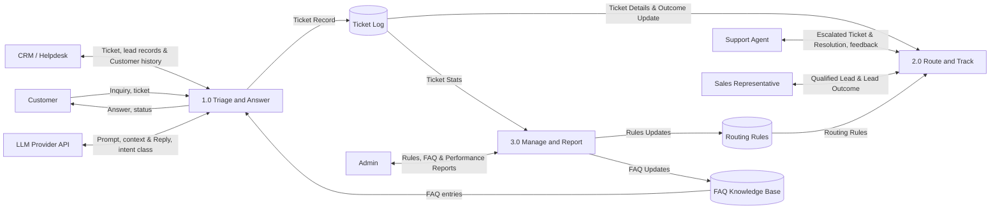

# System Architecture

## 1. Architectural Style
Pattern: Cloud-Native Modular Agentic Pipeline with Event/API Integrations
- **Rationale:** Separates triage, RAG grounding, lead qualification, routing, and admin oversight so latency-sensitive support replies stay fast (< 3.0s) while keeping CRM/helpdesk integrations and human-in-the-loop escalations decoupled and maintainable.

## 2. Component Interaction Diagram (Mermaid)

## 3. Data Flow & Execution Lifecycle
1. **Ingestion:** Customers submit inquiries or support tickets, and incoming records/customer history are exchanged with CRM/helpdesk systems.
2. **Processing:** Process `1.0 Triage and Answer` queries FAQ context and the LLM API to classify intent and draft a response; process `2.0 Route and Track` applies routing rules to assign qualified leads to sales or escalate tickets to support agents.
3. **Persistence & Response:** Ticket records, routing outcomes, FAQ entries, and routing rules are persisted in data stores while responses, escalations, leads, and admin reports are delivered.

## 4. Architecture Decision Records (ADRs)
- **ADR-01 (Cloud-Native Web Architecture over Native Mobile / On-Premise):** SmartRoute AI is scoped as a cloud-native web platform and admin dashboard rather than on-premise deployments or native iOS/Android apps, reducing deployment overhead within the 12-week schedule and $8,500 CAD budget.
- **ADR-02 (RAG Grounding & Confidence Escalation):** Routine support responses are grounded in approved FAQ/documentation sources with confidence thresholds and human escalation fallbacks to mitigate hallucination risks (R-01).
- **ADR-03 (Multi-Provider LLM Fallback & PII Sanitization):** Request caching, async handling, fallback to a secondary LLM provider (OpenAI / Anthropic), and input PII sanitization protect reliability, latency (< 3.0s), and data privacy (R-02, R-05, R-06).